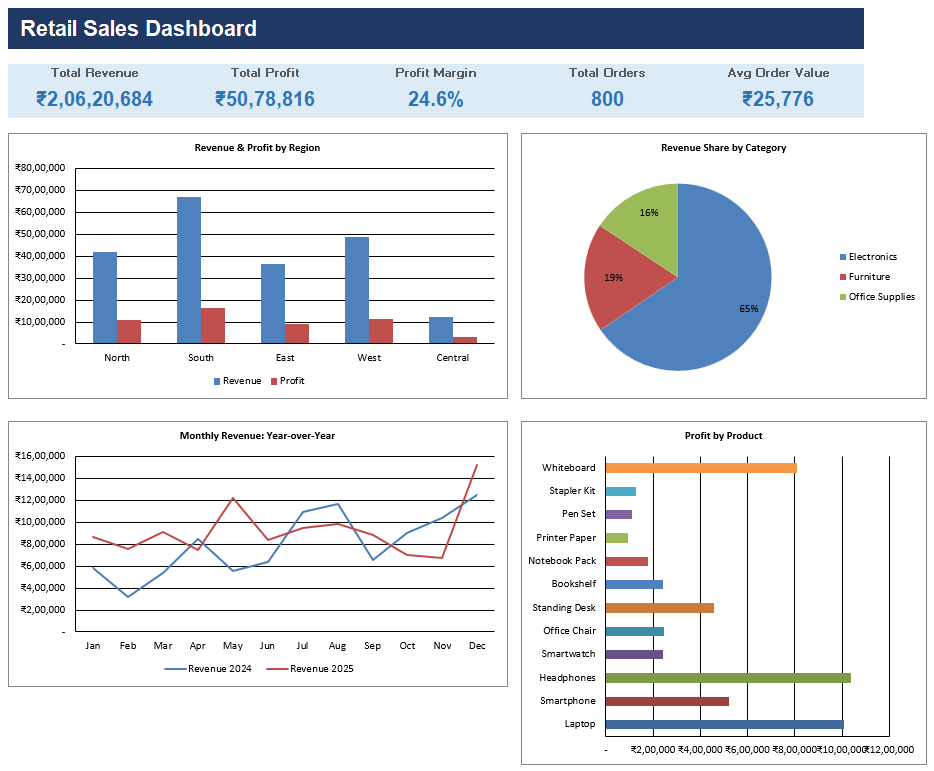

# Retail Sales Analysis — Excel-Only Data Analyst Project


An end-to-end data analysis project built **entirely in Microsoft Excel** (no macros, no Python needed to use it). It covers the full analyst workflow: raw data → cleaning → feature engineering → analysis → dashboard → insights.

> **Note:** The dataset is **synthetic**, generated for portfolio purposes. Currency is INR (₹).

## Business Problem
A multi-region retail company wants to know where revenue and profit come from, which products and categories perform best, and how 2025 compares with 2024.

## Dataset
| Item | Detail |
|---|---|
| Records | 820 rows (800 unique orders + 20 deliberate duplicates) |
| Period | Jan 2024 – Dec 2025 |
| Columns | Order ID, Order Date, Region, Category, Product, Customer Segment, Quantity, Unit Price, Discount, Unit Cost |
| Data issues | Inconsistent text case, leading/trailing spaces, blank discounts, duplicate orders |

## Workbook Structure
| Sheet | Purpose |
|---|---|
| `README` | Project overview, data dictionary, key formulas |
| `Dashboard` | KPI cards + 4 charts linked to the Analysis sheet |
| `Raw_Data` | Untouched source data |
| `Clean_Data` | Formula-based cleaning + calculated columns |
| `Analysis` | KPIs and summary tables (region, category, segment, monthly YoY, product ranking) |
| `Insights` | Auto-updating findings written with formulas |

## Steps Performed
1. **Data cleaning** — `TRIM`, `PROPER` to standardise text; `N()` to treat blank discounts as 0; `COUNTIF` to flag duplicate Order IDs.
2. **Feature engineering** — `YEAR`, `MONTH`, `TEXT`; Revenue = Qty × Price × (1 − Discount); Profit = Revenue − Cost.
3. **Analysis** — `SUMIFS`, `COUNTIFS`, `INDEX/MATCH`, `RANK`, `IFERROR`; duplicates excluded from every metric.
4. **Visualisation** — clustered column, pie, line (YoY) and bar charts; data bars and colour scales via conditional formatting.
5. **Insights** — text built from live formulas so it updates if the data changes.

## Key Findings
- Total revenue **₹2.06 crore** at a **24.6%** profit margin across 800 unique orders.
- Revenue grew **15.2%** from 2024 to 2025.
- **South** is the top region (32.4% of revenue); **Central** is the weakest (5.9%).
- **Electronics** drives 65.5% of revenue, but **Office Supplies** has the best margin (40.8%).
- **Laptop** is the top product by revenue; **Headphones** is the most profitable.
- December 2025 was the peak month.
- 20 duplicate rows were detected and excluded.

## Recommendations
- Protect Electronics volume but push higher-margin accessories (e.g. headphones) alongside laptops and smartphones, whose margins are lowest.
- Investigate why Central contributes under 6% of revenue — a targeted campaign or distribution review could pay off.
- Plan inventory and promotions around the Q4 peak.

## How to Use
1. Download `Retail_Sales_Analysis_Excel_Project.xlsx`.
2. Open in Excel and start at the **Dashboard** sheet.
3. Change the blue year cells on `Analysis` (C35, D35) to compare other years.

## Skills Demonstrated
Data cleaning · Excel formulas (SUMIFS, COUNTIFS, INDEX/MATCH, RANK) · KPI design · Conditional formatting · Dashboarding · Business storytelling

## Suggested Repo Layout
```
retail-sales-excel-analysis/
├── README.md
├── Retail_Sales_Analysis_Excel_Project.xlsx
└── dashboard_screenshot.png   # take a screenshot of the Dashboard sheet
```
